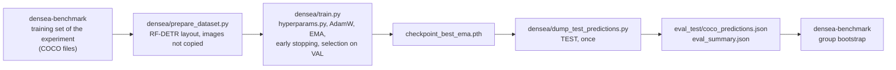

# DenSea RF-DETR

Training and evaluation code for **RF-DETR (Base)** on **DenSea-Aggregated**, the benchmark used in the article
*When Does Synthetic Data Help Underwater Debris Detection? Gap Metrics, Data Regimes and Detector Paradigms*.
It is a derivative of [roboflow/rf-detr](https://github.com/roboflow/rf-detr) (Apache-2.0) and sits next to the
other two detectors of the study, [`densea-rtdetrv2`](https://github.com/asferrer/densea-rtdetrv2) and
[`densea-diffusiondet`](https://github.com/asferrer/densea-diffusiondet). The group-aware partition, the synthetic
batches, the experiment definitions and the bootstrap evaluation are in
[`densea-benchmark`](https://github.com/asferrer/densea-benchmark); this repository is the detector it calls.

## What changes with respect to upstream

Based on upstream commit [`750f1e7`](https://github.com/roboflow/rf-detr/commit/750f1e7cf543d07e533f1c85def2d46e7a9f5b75)
(version 1.5.0.rc2, 2026-02-22). The first commit of this repository is that snapshot, so `git diff HEAD~1` shows
exactly what was changed. The details are in [`CHANGES.md`](CHANGES.md); in short:

- **Selection of the model on the EMA weights.** `eval_regular_model=False` skips the per-epoch evaluation of the
  regular weights, the best-metric holder keeps one maximum per model (regular and EMA) and
  `checkpoint_best_ema.pth` is the model evaluated on the test split.
- **Resume.** On `resume`, the best value and the early-stopping counter are rebuilt from `log.txt`, so a restarted
  run keeps its patience and does not overwrite the best checkpoint with a worse epoch.
- **Faster evaluation.** `FAST_COCOEVAL=1` computes COCO metrics with
  [faster-coco-eval](https://github.com/MiXaiLL76/faster_coco_eval); the results match pycocotools to 1e-15.
- **Data loading and memory.** Pinned memory and persistent workers in the data loaders, and cache clean-up between
  epochs.
- **Drop-path schedule.** The drop-path update handles the DINOv2 wrapper used by the Base model.
- **`densea/`:** the hyperparameters of the study (`hyperparams.py`), a training and test launcher (`train.py`), a
  converter from the DenSea-Aggregated annotations to the RF-DETR layout (`prepare_dataset.py`) and a script that
  dumps the test detections in COCO format (`dump_test_predictions.py`).
- Removed: the documentation site, CI workflows, the GPU benchmark tests and the files of upstream that are
  specific to its own tooling.

## Workflow

The experiments are defined and evaluated in `densea-benchmark`; this repository trains one detector and writes its detections:



## Installation

With Docker (NVIDIA Container Toolkit and a GPU with 24 GB or more; the study used an RTX 5090):

```bash
DATA_ROOT=/path/to/densea_aggregated RUNS_DIR=/path/to/runs docker compose up -d --build
docker exec -it densea_rfdetr bash
```

Without Docker (Python 3.11, PyTorch 2.7.0 with CUDA 12.8):

```bash
pip install -r requirements-pinned.txt
pip install --no-deps -e .
```

`requirements-pinned.txt` lists the versions used for the reported results.

## Data

Download **DenSea-Aggregated** (*DenSea-Aggregated: A Group-Aware Benchmark for Underwater Debris Detection*) from the [dataset page of the University of Alicante group](https://www.dlsi.ua.es/~jgallego/datasets/) and unpack it; it contains
`annotations/{train,val,test}.json` (COCO, 8 classes, with a `group` per image) and the `images/` folder.
The partition is by groups of near-duplicate images, so no group appears in two splits (995 / 204 / 217 groups;
10,245 / 2,185 / 2,207 images). Convert it to the layout RF-DETR reads (the images are not copied; `/data` is mounted read-only, so the converted files go under `/runs`):

```bash
python densea/prepare_dataset.py \
    --annotations-dir /data/annotations \
    --image-root /data \
    --out-dir /runs/rfdetr_data/real_only
```

To train with a synthetic batch, add `--extra-train-json batch/annotations.json --extra-image-root batch/images`.
The synthetic batches and the training sets of each experiment are built by `densea-benchmark`, which writes this
same layout.

## Training and evaluation

```bash
python densea/train.py --dataset-dir /runs/rfdetr_data/real_only --output-dir /runs/real_only --seed 21
```

Setup (`densea/hyperparams.py`): RF-DETR Base initialised from the COCO weights, resolution 560, AdamW with a
learning rate of 5e-5 (5e-6 in the encoder), weight decay 0.05, cosine schedule with 6 warm-up epochs, effective
batch size 32 (8 x 4 accumulation steps), EMA 0.9998, multi-scale training, underwater augmentation preset, up to
200 epochs and early stopping after 20 epochs without an improvement of 0.001 in the validation AP of the EMA
weights. The test split is only used once, at the end, with `checkpoint_best_ema.pth`.

The script writes `<output-dir>/eval_test/coco_predictions.json` (all detections) and `eval_summary.json` (AP, AP50,
AP75 with pycocotools, at most 100 detections per image). Group-bootstrap confidence intervals and the comparison
between strategies come from the evaluation scripts of `densea-benchmark`, which read the detections file.
Training resumes from `<output-dir>/checkpoint.pth` when it exists. The unit tests (CPU only) run with
`python -m pytest -m "not gpu" tests`.

## Expected results

AP@[.5:.95] (x100) of RF-DETR Base, mean of three training seeds (21, 22, 23) with 95 % confidence intervals from a
bootstrap over groups (2,000 resamples). The three arms are: Real-Only, Minority-Focus (clean backgrounds; synthetic objects of the rare classes) and Standard (copy-paste; all synthetic images added).

| Arm | Validation AP | AP50 | AP75 | Test AP | AP50 | AP75 |
|---|---|---|---|---|---|---|
| Real-Only | 43.52 [39.44; 49.76] | 63.57 | 46.75 | 44.47 [40.74; 50.35] | 65.30 | 47.75 |
| Minority-Focus (clean backgrounds) | 42.96 [38.97; 48.74] | 63.43 | 45.44 | 43.11 [39.88; 48.01] | 64.20 | 46.07 |
| Standard (copy-paste) | 43.36 [39.31; 48.16] | 62.30 | 46.84 | 43.59 [40.67; 48.13] | 63.89 | 46.63 |

The standard deviation between seeds is 0.04 to 0.44 AP. For RF-DETR no synthetic arm improves on Real-Only
(Minority-Focus minus Real-Only on test: -1.36 AP, 95 % CI [-3.21; +0.02]). The numbers above are the reference
for a reproduction on the same partition; small differences between seeds are expected.

## Citation

If you use this code, please cite the article, the dataset and the upstream detector:

```bibtex
@article{sanchezferrer2026synthetic,
  title   = {When Does Synthetic Data Help Underwater Debris Detection? Gap Metrics, Data Regimes and Detector Paradigms},
  author  = {S{\'a}nchez-Ferrer, Alejandro and Gallego, Antonio Javier and Calvo-Zaragoza, Jorge},
  journal = {Neurocomputing},
  year    = {2026},
  note    = {Manuscript in preparation}
}

@dataset{sanchezferrer2026densea,
  title     = {{DenSea-Aggregated}: A Group-Aware Benchmark for Underwater Debris Detection},
  author    = {S{\'a}nchez-Ferrer, Alejandro and Gallego, Antonio Javier and Calvo-Zaragoza, Jorge},
  year      = {2026},
  publisher = {University of Alicante},
  url       = {https://www.dlsi.ua.es/~jgallego/datasets/}
}

@misc{robinson2025rfdetr,
  title         = {{RF-DETR}: Neural Architecture Search for Real-Time Detection Transformers},
  author        = {Robinson, Isaac and Robicheaux, Peter and Popov, Matvei and Ramanan, Deva and Peri, Neehar},
  year          = {2025},
  eprint        = {2511.09554},
  archivePrefix = {arXiv}
}
```

## License

Apache License 2.0, as upstream (see [`LICENSE`](LICENSE) and [`NOTICE`](NOTICE)). The `src/rfdetr/platform/`
package is Apache-2.0 too; it only forwards to the optional `rfdetr_plus` package, which provides the XL and 2XL
models under a separate license and is not part of this repository or of the study. Pretrained weights downloaded
by RF-DETR keep the license of upstream.
